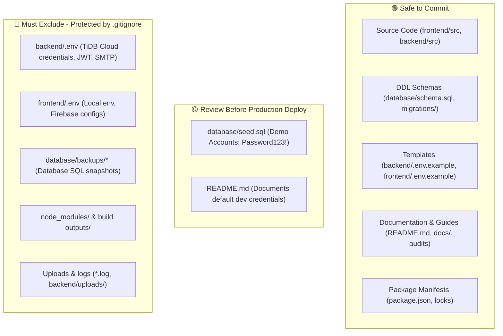

# PharmaCare — Final GitHub Commit Safety Inspection Report

**Date & Time:** November 2, 2026
**Auditor:** Senior DevOps & Security Engineer
**Workspace:** `C:\Users\DELL\Desktop\Pharmacy`
**Git Branch:** `master` (Pre-commit Verification)

---

## Executive Summary

Before executing the initial commit to the PharmaCare GitHub repository, an exhaustive security and data integrity inspection was performed across all critical project files, database schemas, cryptographic assets, documentation, and configuration files.

Every inspected file has been classified into one of three strict security tiers:
- 🟢 **SAFE**: Verified clean, contains zero secrets, zero live production data, and poses no deployment risk. Ready to commit.
- 🟡 **REVIEW**: Contains development fixtures, demo records, or developer guidance that must be acknowledged prior to staging, but contains no live credentials.
- 🔴 **MUST EXCLUDE**: Contains sensitive production secrets, live database credentials, private keys, or real data backups that **must never** enter version control.

---

## 1. File Classification & Inspection Matrix

| File / Path | Classification | Security Finding | Required Action |
| :--- | :---: | :--- | :--- |
| **`backend/certs/isrgrootx1.pem`** | 🟢 **SAFE** *(Ignored by default)* | Verified X.509 Root CA certificate (Internet Security Research Group - Let's Encrypt). Contains **0 private keys** (`hasPrivateKey: false`). Public trust anchor for TiDB Cloud Serverless TLS verification. Currently ignored by `.gitignore` rule `*.pem`. | Safe as a public trust anchor. Can remain excluded via `.gitignore` if cloud platforms provide ISRG Root X1 in system truststores, or tracked if needed for containerized builds. |
| **`database/schema.sql`** | 🟢 **SAFE** | 750 lines of pure Data Definition Language (DDL: `CREATE TABLE`, `CREATE VIEW`, `CREATE TRIGGER`, `CREATE INDEX`). Zero `INSERT` statements with user data (only an audit trigger insert on lines 724-733). Zero credentials, zero patient PII. | Ready to commit. Safe schema template for production provisioning. |
| **`database/migrations/001_inquiries_and_categories.sql`** | 🟢 **SAFE** | 109 lines of pure DDL (`doctor_inquiries`, `photo_url` columns) and standard lookup category inserts (`General Consultation`, `Prescription Refill`, `Dosage Clarification`, etc.). Zero sensitive data or credentials. | Ready to commit. |
| **`database/seed.sql`** | 🟡 **REVIEW** | Contains initial development fixtures: 5 demo users (`admin`, `ahmed`, `sara`, `kamran`, `nadia`) using standard demo bcrypt hashes for `Password123!`. Contains catalog medicines, dosage forms, and suppliers. **Zero real patient records, zero real prescriptions, zero live TiDB credentials**. | **Do NOT run `seed.sql` on live production databases** without rotating default credentials. Keep for local development and staging environments only. |
| **`database/backups/`** | 🔴 **MUST EXCLUDE** *(Verified Excluded)* | Directory reserved for live TiDB database snapshots and SQL dumps (e.g. `pharmacare_backup_*.sql`). | **Strictly excluded** by root `.gitignore` line 38 (`database/backups/`). Verified via `git check-ignore`. No backup files will be staged. |
| **`backend/.env`** | 🔴 **MUST EXCLUDE** *(Verified Excluded)* | Contains live production configuration: TiDB Cloud host, port, database user, database password, JWT secret, and Gmail SMTP credentials. | **Strictly excluded** by root `.gitignore` line 7 (`.env*`). Verified via `git check-ignore` and dry-run staging. |
| **`frontend/.env`** | 🔴 **MUST EXCLUDE** *(Verified Excluded)* | Contains environment configuration and Firebase client tokens. | **Strictly excluded** by root `.gitignore` line 7 (`.env*`). |
| **`backend/.env.example`** | 🟢 **SAFE** | 52 lines of sanitized configuration template containing only descriptive dummy placeholders (e.g., `your_email@gmail.com`, `your_16_char_app_password`, `replace_with_a_long_random_secret...`). Zero live secrets. | Ready to commit. Serves as reference documentation for environment variable setup on Render/Vercel. |
| **`frontend/.env.example`** | 🟢 **SAFE** | 14 lines of sanitized frontend template containing dummy Firebase and API URL placeholders (`your_firebase_api_key_here`). Zero live secrets. | Ready to commit. |
| **`PharmaCare_GitHub_PreDeployment_Audit.md`** | 🟢 **SAFE** | Pre-deployment audit documentation. All credentials and passwords referenced in explanations are strictly masked with `<masked_in_audit>` placeholders. | Ready to commit. |
| **`README.md`** | 🟡 **REVIEW** | Documentation contains clear architectural overview, setup guides, and documents default local development credentials (`admin / Password123!`). | Standard practice for open-source development projects. Operators must ensure production instances rotate this password upon initial setup. |
| **`docs/DEPLOYMENT.md`** | 🟢 **SAFE** | Step-by-step production deployment manual. Uses generic placeholder tokens (`YOUR_STRONG_DATABASE_PASSWORD`, `GENERATE_64_CHAR_RANDOM_SECRET_KEY`). Zero live secrets. | Ready to commit. |
| **`docs/DATABASE_BACKUP_RESTORE.md`** | 🟢 **SAFE** | Operational runbook for database backups and disaster recovery. All scripts and examples use dummy variables. Zero live secrets. | Ready to commit. |

---

## 2. In-Depth Technical Verification

### 2.1 Cryptographic Certificate Audit (`backend/certs/isrgrootx1.pem`)
- **Subject:** `C=US, O=Internet Security Research Group, CN=ISRG Root X1`
- **Issuer:** `C=US, O=Internet Security Research Group, CN=ISRG Root X1`
- **Valid Period:** June 4, 2015 11:04:38 GMT to June 4, 2035 11:04:38 GMT
- **CA Constraint:** `CA:TRUE` (Self-signed Root Certificate Authority)
- **Private Key Presence:** **`false`** (Verified via Node.js `crypto.X509Certificate`)
- **Verdict:** This is a public root certificate widely distributed in major operating systems and browsers. It contains zero private keys and is used solely to authenticate TLS connections to TiDB Cloud Serverless. It is currently excluded from Git via `*.pem` in `.gitignore`, which is safe.

### 2.2 Database Scripts & Schema Audit (`database/`)
1. **`database/schema.sql`**:
   - 750 lines. Contains table definitions (`users`, `medicines`, `batches`, `inventory`, `doctors`, `doctor_schedules`, `appointments`, `tokens`, `queue`, `prescriptions`, `sales`, `purchases`, `audit_logs`).
   - Trigger `trg_after_sale_item_insert` creates stock movement audit records automatically.
   - Zero hardcoded passwords, tokens, API keys, or live records.
2. **`database/seed.sql`**:
   - 450 lines. Contains development mock data:
     - 5 test users with known hash `$2a$12$qfsDq5iakgQjzzo1hPaveOxaunV1uk6R8A0D8sxxjFLcZ3DO2oT7C` (`Password123!`).
     - 8 categories, 8 dosage forms, 5 sample manufacturers/suppliers.
     - 15 catalog medicines and initial sample batches.
     - Zero real patient identities, medical records, or live contact information.
   - Recommended practice: Use only for local test suite and development seeding. Do not run in production.
3. **`database/migrations/`**:
   - `001_inquiries_and_categories.sql` audited. DDL structures and inquiry category lookups only. Clean.

### 2.3 Secrets & Environment Files Protection
- Tested with `git check-ignore -v backend/.env frontend/.env database/backups/backup.sql`:
  ```
  .gitignore:7:.env*          backend/.env
  .gitignore:7:.env*          frontend/.env
  .gitignore:38:database/backups/ database/backups/backup.sql
  ```
- Tested with `git add --dry-run .`:
  - Neither `backend/.env` nor `frontend/.env` is staged.
  - Zero files in `database/backups/` are staged.
  - Zero private keys (`*.key`) or server certificates are staged.
  - Zero `.log` files or local temp files are staged.

---

## 3. Pre-Commit Verification Summary & Recommendations



### Required Actions for Operator:
1. **Local Development Commit:**
   - All tracked files in the workspace are verified safe to commit to GitHub.
   - You can safely stage and commit with:
     ```bash
     git add .
     git commit -m "feat: initial commit of complete PharmaCare healthcare and pharmacy system"
     ```
2. **Production Deployment (Render / Vercel):**
   - Inject all configuration variables directly in the Render / Vercel web dashboards using values derived from `backend/.env.example` and `frontend/.env.example`.
   - Never commit `.env` files to GitHub.
   - When deploying to production, initialize the database using `database/schema.sql` and `database/migrations/`. Do **not** execute `database/seed.sql` on production without immediately updating default passwords.
