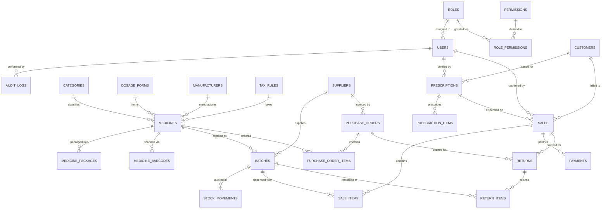

# PharmaCare — Database Data Dictionary

> **Database Name:** `pharmacare_db`
> **Target RDBMS:** MySQL 8.0+ / MariaDB 10.4+ (InnoDB Engine)
> **Character Set:** `utf8mb4` | **Collation:** `utf8mb4_unicode_ci`
> **Timezone Strategy:** Coordinated Universal Time (UTC) stored in all database timestamps; translated to local business timezone (`Asia/Karachi`, UTC+5) by application presentation layer.
> **Monetary Standard:** `DECIMAL(12,2)` used exclusively for all monetary values. Floating-point types (`FLOAT`, `DOUBLE`) are strictly forbidden to prevent floating-point rounding errors.

---

## 1. Domain Architecture Overview

The `pharmacare_db` schema is divided into 7 cohesive domain groups:

---

## 2. Table-by-Table Data Dictionary

### 2.1 Security, Users & Auditing

#### `roles`
Stores application roles determining access levels across the system.
| Column | Type | Nullable | Default | Description & Rules |
|---|---|---|---|---|
| `id` | `INT UNSIGNED` | No | Auto-Inc | Primary Key |
| `name` | `VARCHAR(50)` | No | — | Unique internal role name (`admin`, `pharmacist`, `stock_manager`, `cashier`) |
| `display_name` | `VARCHAR(100)` | No | — | Human-readable role label |
| `description` | `VARCHAR(255)` | Yes | NULL | Role scope explanation |
| `is_system_role` | `BOOLEAN` | No | `FALSE` | When `TRUE`, system prevents deletion of essential root roles |
| `created_at` | `TIMESTAMP` | No | `CURRENT_TIMESTAMP` | Row creation timestamp |
| `updated_at` | `TIMESTAMP` | No | `CURRENT_TIMESTAMP` | Auto-updated modification timestamp |

#### `permissions`
Fine-grained authorization flags mapped to software functions.
| Column | Type | Nullable | Default | Description & Rules |
|---|---|---|---|---|
| `id` | `INT UNSIGNED` | No | Auto-Inc | Primary Key |
| `code` | `VARCHAR(100)` | No | — | Unique permission key (e.g. `pos:dispense`, `rx:verify`, `inventory:adjust`) |
| `module` | `VARCHAR(50)` | No | — | Grouping module (e.g. `pos`, `prescriptions`, `reports`, `settings`) |
| `description` | `VARCHAR(255)` | No | — | Clinical or operational purpose of permission |
| `created_at` | `TIMESTAMP` | No | `CURRENT_TIMESTAMP` | Row creation timestamp |

#### `role_permissions`
Many-to-many junction table between roles and permissions.
| Column | Type | Nullable | Default | Description & Rules |
|---|---|---|---|---|
| `role_id` | `INT UNSIGNED` | No | — | Foreign Key -> `roles(id)` ON DELETE CASCADE |
| `permission_id` | `INT UNSIGNED` | No | — | Foreign Key -> `permissions(id)` ON DELETE CASCADE |
*Composite Primary Key: (`role_id`, `permission_id`)*

#### `users`
Authenticated staff members operating the application.
| Column | Type | Nullable | Default | Description & Rules |
|---|---|---|---|---|
| `id` | `INT UNSIGNED` | No | Auto-Inc | Primary Key |
| `role_id` | `INT UNSIGNED` | No | — | Foreign Key -> `roles(id)` ON DELETE RESTRICT |
| `username` | `VARCHAR(50)` | No | — | Unique login handle |
| `email` | `VARCHAR(100)` | No | — | Unique staff email address |
| `password_hash` | `VARCHAR(255)` | No | — | Salted bcrypt hash with cost factor >= 12 |
| `full_name` | `VARCHAR(150)` | No | — | Employee complete legal name |
| `phone` | `VARCHAR(30)` | Yes | NULL | Contact phone number |
| `status` | `ENUM('active','inactive')` | No | `'active'` | Inactive users are rejected at authentication middleware |
| `last_login_at` | `TIMESTAMP` | Yes | NULL | Timestamp of most recent verified sign-in |
| `created_at` | `TIMESTAMP` | No | `CURRENT_TIMESTAMP` | Account creation timestamp |
| `updated_at` | `TIMESTAMP` | No | `CURRENT_TIMESTAMP` | Account update timestamp |
| `deleted_at` | `TIMESTAMP` | Yes | NULL | Soft-deletion flag preserving historical audit integrity |

#### `audit_logs`
Immutable, append-only operational log recording every state alteration in the database.
| Column | Type | Nullable | Default | Description & Rules |
|---|---|---|---|---|
| `id` | `BIGINT UNSIGNED` | No | Auto-Inc | Primary Key |
| `user_id` | `INT UNSIGNED` | Yes | NULL | Foreign Key -> `users(id)` ON DELETE SET NULL |
| `action` | `ENUM(...)` | No | — | Action verb (`CREATE`, `UPDATE`, `DELETE`, `LOGIN`, `LOGOUT`, `VIEW_SENSITIVE`, `STATUS_CHANGE`, `OVERRIDE`) |
| `table_name` | `VARCHAR(64)` | No | — | Name of modified entity table |
| `record_id` | `VARCHAR(64)` | Yes | NULL | Primary key of target record |
| `old_values` | `JSON` | Yes | NULL | Full JSON state snapshot before modification |
| `new_values` | `JSON` | Yes | NULL | Full JSON state snapshot after modification |
| `ip_address` | `VARCHAR(45)` | Yes | NULL | IPv4 or IPv6 client origin address |
| `user_agent` | `VARCHAR(255)` | Yes | NULL | HTTP client device identifier |
| `created_at` | `TIMESTAMP` | No | `CURRENT_TIMESTAMP` | Exact time of event (UTC) |

---

### 2.2 Medicine Catalogue & Master Data

#### `categories`
Therapeutic classifications (e.g., Analgesics, Antibiotics, Antidiabetics).
| Column | Type | Nullable | Default | Description & Rules |
|---|---|---|---|---|
| `id` | `INT UNSIGNED` | No | Auto-Inc | Primary Key |
| `name` | `VARCHAR(100)` | No | — | Unique category title |
| `description` | `VARCHAR(255)` | Yes | NULL | Clinical summary of category |
| `is_active` | `BOOLEAN` | No | `TRUE` | Whether visible in product creation |
| `created_at` | `TIMESTAMP` | No | `CURRENT_TIMESTAMP` | Row creation timestamp |
| `updated_at` | `TIMESTAMP` | No | `CURRENT_TIMESTAMP` | Row update timestamp |

#### `dosage_forms`
Pharmaceutical physical forms (Tablet, Capsule, Syrup, Inhaler, Sachet, etc.).
| Column | Type | Nullable | Default | Description & Rules |
|---|---|---|---|---|
| `id` | `INT UNSIGNED` | No | Auto-Inc | Primary Key |
| `name` | `VARCHAR(100)` | No | — | Unique dosage form name |
| `description` | `VARCHAR(255)` | Yes | NULL | Administration route explanation |
| `is_active` | `BOOLEAN` | No | `TRUE` | Active flag |
| `created_at` | `TIMESTAMP` | No | `CURRENT_TIMESTAMP` | Row creation timestamp |
| `updated_at` | `TIMESTAMP` | No | `CURRENT_TIMESTAMP` | Row update timestamp |

#### `manufacturers`
Licensed pharmaceutical producers.
| Column | Type | Nullable | Default | Description & Rules |
|---|---|---|---|---|
| `id` | `INT UNSIGNED` | No | Auto-Inc | Primary Key |
| `name` | `VARCHAR(150)` | No | — | Unique corporate or trading name |
| `country` | `VARCHAR(100)` | No | `'Pakistan'` | Country of origin |
| `contact_person` | `VARCHAR(100)` | Yes | NULL | Account executive |
| `phone` | `VARCHAR(50)` | Yes | NULL | Telephone contact |
| `email` | `VARCHAR(100)` | Yes | NULL | Regulatory or support email |
| `license_number`| `VARCHAR(100)` | Yes | NULL | DRAP manufacturing registration reference |
| `is_active` | `BOOLEAN` | No | `TRUE` | Active trading flag |
| `created_at` | `TIMESTAMP` | No | `CURRENT_TIMESTAMP` | Row creation timestamp |
| `updated_at` | `TIMESTAMP` | No | `CURRENT_TIMESTAMP` | Row update timestamp |

#### `medicines`
Master pharmaceutical product catalogue. Multiple strengths (e.g. 250mg vs 500mg) are distinct rows.
| Column | Type | Nullable | Default | Description & Rules |
|---|---|---|---|---|
| `id` | `INT UNSIGNED` | No | Auto-Inc | Primary Key |
| `generic_name` | `VARCHAR(150)` | No | — | International Nonproprietary Name (INN) |
| `brand_name` | `VARCHAR(150)` | No | — | Commercial proprietary trade brand |
| `category_id` | `INT UNSIGNED` | No | — | Foreign Key -> `categories(id)` ON DELETE RESTRICT |
| `dosage_form_id`| `INT UNSIGNED`| No | — | Foreign Key -> `dosage_forms(id)` ON DELETE RESTRICT |
| `manufacturer_id`|`INT UNSIGNED`| Yes | NULL | Foreign Key -> `manufacturers(id)` ON DELETE SET NULL |
| `strength` | `VARCHAR(50)` | No | — | Numeric dose quantifier (e.g. `500`, `250`, `100`) |
| `strength_unit` | `VARCHAR(20)` | No | `'mg'` | Unit of measure (`mg`, `mcg`, `g`, `ml`, `IU`, `%`) |
| `description` | `TEXT` | Yes | NULL | Clinical monograph or dispensary notes |
| `barcode` | `VARCHAR(100)` | Yes | NULL | Primary retail barcode (Unique) |
| `requires_prescription`|`BOOLEAN`| No | `FALSE` | Triggers prescription prompt and validation during POS |
| `tax_rule_id` | `INT UNSIGNED` | Yes | NULL | Foreign Key -> `tax_rules(id)` ON DELETE SET NULL |
| `reorder_level` | `INT UNSIGNED` | No | `50` | Stock threshold below which automatic low-stock alerts trigger |
| `status` | `ENUM('active','discontinued')`| No | `'active'` | Discontinued drugs cannot be ordered on new POs |
| `created_at` | `TIMESTAMP` | No | `CURRENT_TIMESTAMP` | Row creation timestamp |
| `updated_at` | `TIMESTAMP` | No | `CURRENT_TIMESTAMP` | Row update timestamp |
| `deleted_at` | `TIMESTAMP` | Yes | NULL | Soft-deletion flag |

#### `medicine_packages`
Configurable packaging sizes per medicine (e.g. Strip of 10, Box of 10 Strips).
| Column | Type | Nullable | Default | Description & Rules |
|---|---|---|---|---|
| `id` | `INT UNSIGNED` | No | Auto-Inc | Primary Key |
| `medicine_id` | `INT UNSIGNED` | No | — | Foreign Key -> `medicines(id)` ON DELETE CASCADE |
| `package_label` | `VARCHAR(100)` | No | — | Descriptive label (e.g. "Strip of 10 Tablets") |
| `units_per_package`|`INT UNSIGNED`| No | `1` | Quantity of dispensing base units contained |
| `is_default_sale_unit`|`BOOLEAN`| No | `FALSE` | Pre-selected default unit at POS |
| `created_at` | `TIMESTAMP` | No | `CURRENT_TIMESTAMP` | Row creation timestamp |
| `updated_at` | `TIMESTAMP` | No | `CURRENT_TIMESTAMP` | Row update timestamp |

---

### 2.3 Batch Inventory & Stock Tracking

#### `batches`
The foundational table for inventory, expiry tracking, FEFO dispatch, and pricing.
| Column | Type | Nullable | Default | Description & Rules |
|---|---|---|---|---|
| `id` | `INT UNSIGNED` | No | Auto-Inc | Primary Key |
| `batch_number` | `VARCHAR(60)` | No | — | Manufacturer production lot number |
| `medicine_id` | `INT UNSIGNED` | No | — | Foreign Key -> `medicines(id)` ON DELETE RESTRICT |
| `supplier_id` | `INT UNSIGNED` | Yes | NULL | Foreign Key -> `suppliers(id)` ON DELETE SET NULL |
| `manufacturing_date`|`DATE` | Yes | NULL | Date of batch production |
| `expiry_date` | `DATE` | No | — | Critical shelf-life expiration date |
| `received_date` | `DATE` | No | `CURRENT_DATE` | Date inventory received at pharmacy |
| `initial_quantity`|`INT UNSIGNED`| No | — | Original received count in base units |
| `quantity_on_hand`|`INT UNSIGNED`| No | — | Current physical stock count. Constraint: `>= 0` |
| `cost_price` | `DECIMAL(12,2)` | No | — | Acquisition cost per base unit in base currency |
| `selling_price`| `DECIMAL(12,2)` | No | — | Retail dispensing price per base unit in base currency |
| `status` | `ENUM('active','expired','recalled','quarantined','exhausted')`| No | `'active'` | Only `'active'` batches can be selected for dispensing |
| `quarantine_reason`|`VARCHAR(255)`| Yes | NULL | Regulatory or physical defect rationale for quarantine |
| `created_at` | `TIMESTAMP` | No | `CURRENT_TIMESTAMP` | Row creation timestamp |
| `updated_at` | `TIMESTAMP` | No | `CURRENT_TIMESTAMP` | Row update timestamp |
*Unique Constraint: (`medicine_id`, `batch_number`)*
*FEFO Index: (`medicine_id`, `status`, `expiry_date`, `quantity_on_hand`)*

#### `stock_movements`
Double-entry inventory audit ledger. Every change to physical stock writes a row here.
| Column | Type | Nullable | Default | Description & Rules |
|---|---|---|---|---|
| `id` | `BIGINT UNSIGNED`| No | Auto-Inc | Primary Key |
| `batch_id` | `INT UNSIGNED` | No | — | Foreign Key -> `batches(id)` ON DELETE RESTRICT |
| `movement_type` | `ENUM(...)` | No | — | Action (`PURCHASE_RECEIPT`, `SALE_DISPENSE`, `SALE_RETURN`, `PURCHASE_RETURN`, `DAMAGE_DISPOSAL`, `EXPIRED_WRITE_OFF`, `AUDIT_ADJUSTMENT`) |
| `quantity_change`| `INT` | No | — | Signed integer: `+X` for additions, `-X` for deductions |
| `previous_quantity`|`INT UNSIGNED`| No | — | Balance before transaction |
| `new_quantity` | `INT UNSIGNED` | No | — | Balance after transaction |
| `reference_type`| `VARCHAR(50)` | No | — | Context entity (`sale`, `purchase_order`, `return`, `adjustment`) |
| `reference_id` | `VARCHAR(50)` | Yes | NULL | Primary reference ID (e.g. `INV-2024-0023`, `PO-2024-041`) |
| `reason` | `VARCHAR(255)` | Yes | NULL | Justification for stock alteration |
| `performed_by_user_id`|`INT UNSIGNED`| Yes | NULL | Foreign Key -> `users(id)` ON DELETE SET NULL |
| `created_at` | `TIMESTAMP` | No | `CURRENT_TIMESTAMP` | Ledger timestamp (UTC) |

---

### 2.4 Purchases & Procurement

#### `purchase_orders`
Invoices and orders from pharmaceutical distributors.
| Column | Type | Nullable | Default | Description & Rules |
|---|---|---|---|---|
| `id` | `INT UNSIGNED` | No | Auto-Inc | Primary Key |
| `po_number` | `VARCHAR(50)` | No | — | Unique PO identifier (e.g. `PO-2024-041`) |
| `supplier_id` | `INT UNSIGNED` | No | — | Foreign Key -> `suppliers(id)` ON DELETE RESTRICT |
| `order_date` | `DATE` | No | `CURRENT_DATE` | Date purchase finalized |
| `expected_delivery_date`|`DATE` | Yes | NULL | Scheduled delivery date |
| `received_date` | `DATE` | Yes | NULL | Date warehouse goods inspected |
| `supplier_invoice_number`|`VARCHAR(100)`| Yes | NULL | Distributor's external paper invoice number |
| `currency_code`| `CHAR(3)` | No | `'PKR'` | Foreign Key -> `currencies(code)` |
| `exchange_rate`| `DECIMAL(12,6)`| No | `1.000000`| Currency conversion multiplier at purchase |
| `subtotal_amount`|`DECIMAL(12,2)`| No | `0.00` | Net sum of item costs |
| `discount_amount`|`DECIMAL(12,2)`| No | `0.00` | Commercial discount granted |
| `tax_amount` | `DECIMAL(12,2)` | No | `0.00` | Input GST amount |
| `total_amount` | `DECIMAL(12,2)` | No | `0.00` | Gross total payable |
| `status` | `ENUM('draft','ordered','partial','received','cancelled')`| No | `'draft'` | Lifecycle stage |
| `notes` | `TEXT` | Yes | NULL | Logistics annotations |
| `created_by_user_id`|`INT UNSIGNED`| No | — | Foreign Key -> `users(id)` |
| `created_at` | `TIMESTAMP` | No | `CURRENT_TIMESTAMP` | Row creation timestamp |
| `updated_at` | `TIMESTAMP` | No | `CURRENT_TIMESTAMP` | Row update timestamp |

#### `purchase_order_items`
Individual medicine lots received per purchase invoice.
| Column | Type | Nullable | Default | Description & Rules |
|---|---|---|---|---|
| `id` | `INT UNSIGNED` | No | Auto-Inc | Primary Key |
| `purchase_order_id`|`INT UNSIGNED`| No | — | Foreign Key -> `purchase_orders(id)` ON DELETE CASCADE |
| `medicine_id` | `INT UNSIGNED` | No | — | Foreign Key -> `medicines(id)` ON DELETE RESTRICT |
| `package_id` | `INT UNSIGNED` | Yes | NULL | Foreign Key -> `medicine_packages(id)` |
| `batch_number` | `VARCHAR(60)` | No | — | Manufacturer lot number |
| `manufacturing_date`|`DATE` | Yes | NULL | Date manufactured |
| `expiry_date` | `DATE` | No | — | Shelf life expiry |
| `ordered_quantity`|`INT UNSIGNED`| No | — | Quantity purchased |
| `received_quantity`|`INT UNSIGNED`| No | `0` | Quantity physically verified and received |
| `unit_cost_price`|`DECIMAL(12,2)`| No | — | Unit purchase price |
| `unit_selling_price`|`DECIMAL(12,2)`| No | — | Unit retail price to configure on batch |
| `tax_rate` | `DECIMAL(5,2)` | No | `0.00` | Input GST rate applied |
| `tax_amount` | `DECIMAL(12,2)` | No | `0.00` | Calculated input tax |
| `line_total` | `DECIMAL(12,2)` | No | — | Net line item total |

---

### 2.5 Prescriptions (Restricted Clinical Access)

#### `prescriptions`
Formal medical authorization required for Schedule G / Rx-only pharmaceuticals. Access restricted to Pharmacists and Administrators.
| Column | Type | Nullable | Default | Description & Rules |
|---|---|---|---|---|
| `id` | `INT UNSIGNED` | No | Auto-Inc | Primary Key |
| `prescription_number`|`VARCHAR(50)`| No | — | Unique Rx identifier (e.g. `RX-2024-088`) |
| `customer_id` | `INT UNSIGNED` | Yes | NULL | Foreign Key -> `customers(id)` |
| `patient_name` | `VARCHAR(150)` | No | — | Patient legal name |
| `patient_age` | `INT UNSIGNED` | Yes | NULL | Patient age |
| `patient_gender`| `ENUM('male','female','other')`| Yes | NULL | Patient gender |
| `patient_phone`| `VARCHAR(50)` | Yes | NULL | Patient emergency contact |
| `doctor_name` | `VARCHAR(150)` | No | — | Prescribing physician name |
| `doctor_license_no`|`VARCHAR(100)`| Yes | NULL | Physician regulatory registration number (e.g. PMDC) |
| `clinic_or_hospital`|`VARCHAR(200)`| Yes | NULL | Medical facility name |
| `prescription_date`|`DATE` | No | — | Date written on prescription |
| `prescription_image_path`|`VARCHAR(255)`| Yes | NULL | Secure encrypted path to scanned prescription slip |
| `is_verified` | `BOOLEAN` | No | `FALSE` | Verification gate flag |
| `verified_by_user_id`|`INT UNSIGNED`| Yes | NULL | Foreign Key -> `users(id)`. Must hold `pharmacist` or `admin` role |
| `verified_at` | `TIMESTAMP` | Yes | NULL | Audit timestamp of clinical verification |
| `status` | `ENUM('pending','verified','dispensed','cancelled')`| No | `'pending'` | Current regulatory status |
| `notes` | `TEXT` | Yes | NULL | Clinical dispensing annotations |
| `created_at` | `TIMESTAMP` | No | `CURRENT_TIMESTAMP` | Row creation timestamp |
| `updated_at` | `TIMESTAMP` | No | `CURRENT_TIMESTAMP` | Row update timestamp |

---

### 2.6 Point of Sale (POS) Billing & Dispensing

#### `sales`
Retail sales invoice header.
| Column | Type | Nullable | Default | Description & Rules |
|---|---|---|---|---|
| `id` | `INT UNSIGNED` | No | Auto-Inc | Primary Key |
| `invoice_number`| `VARCHAR(50)` | No | — | Unique commercial invoice number (e.g. `INV-2024-0023`) |
| `customer_id` | `INT UNSIGNED` | Yes | NULL | Foreign Key -> `customers(id)` |
| `sale_timestamp`|`TIMESTAMP` | No | `CURRENT_TIMESTAMP` | Exact time of register sale |
| `currency_code`| `CHAR(3)` | No | `'PKR'` | Foreign Key -> `currencies(code)` |
| `exchange_rate`| `DECIMAL(12,6)`| No | `1.000000`| Rate applied relative to base |
| `subtotal_amount`|`DECIMAL(12,2)`| No | `0.00` | Gross sum before discount & tax |
| `discount_amount`|`DECIMAL(12,2)`| No | `0.00` | Authorized line or total invoice discount |
| `tax_amount` | `DECIMAL(12,2)` | No | `0.00` | Sales tax / GST total |
| `total_amount` | `DECIMAL(12,2)` | No | `0.00` | Net payable balance (`subtotal - discount + tax`) |
| `payment_status`|`ENUM('paid','partially_paid','unpaid','refunded')`| No | `'paid'` | Settlement state |
| `status` | `ENUM('completed','partially_returned','fully_returned','cancelled')`| No | `'completed'` | Invoice status |
| `has_prescription_items`|`BOOLEAN`| No | `FALSE` | Flag indicating regulated drugs dispensed |
| `prescription_id`|`INT UNSIGNED`| Yes | NULL | Foreign Key -> `prescriptions(id)` |
| `cashier_user_id`|`INT UNSIGNED`| No | — | Foreign Key -> `users(id)` (Staff member at register) |
| `notes` | `TEXT` | Yes | NULL | Patient or checkout notes |
| `created_at` | `TIMESTAMP` | No | `CURRENT_TIMESTAMP` | Row creation timestamp |
| `updated_at` | `TIMESTAMP` | No | `CURRENT_TIMESTAMP` | Row update timestamp |

#### `sale_items`
Individual items dispensed on an invoice. Every item is locked directly to a specific batch to guarantee traceability.
| Column | Type | Nullable | Default | Description & Rules |
|---|---|---|---|---|
| `id` | `INT UNSIGNED` | No | Auto-Inc | Primary Key |
| `sale_id` | `INT UNSIGNED` | No | — | Foreign Key -> `sales(id)` ON DELETE CASCADE |
| `batch_id` | `INT UNSIGNED` | No | — | Foreign Key -> `batches(id)` ON DELETE RESTRICT |
| `medicine_id` | `INT UNSIGNED` | No | — | Foreign Key -> `medicines(id)` ON DELETE RESTRICT |
| `quantity` | `INT UNSIGNED` | No | — | Units dispensed. Constraint: `> 0` |
| `unit_price` | `DECIMAL(12,2)` | No | — | Retail price per unit at moment of sale |
| `discount_amount`|`DECIMAL(12,2)`| No | `0.00` | Itemized discount |
| `tax_rate` | `DECIMAL(5,2)` | No | `0.00` | Itemized tax rate percent |
| `tax_amount` | `DECIMAL(12,2)` | No | `0.00` | Itemized tax amount |
| `line_total` | `DECIMAL(12,2)` | No | — | Total line amount |
| `returned_quantity`|`INT UNSIGNED`| No | `0` | Returned unit count. Constraint: `<= quantity` |

---

### 2.7 Returns Workflow

#### `returns`
Returns header handling both customer sales returns and distributor purchase returns.
| Column | Type | Nullable | Default | Description & Rules |
|---|---|---|---|---|
| `id` | `INT UNSIGNED` | No | Auto-Inc | Primary Key |
| `return_number` | `VARCHAR(50)` | No | — | Unique return ticket number (e.g. `RTN-2024-009`) |
| `return_type` | `ENUM('SALE_RETURN','PURCHASE_RETURN')`| No | — | Distinguishes customer refund vs vendor credit |
| `reference_sale_id`|`INT UNSIGNED`| Yes | NULL | Foreign Key -> `sales(id)` |
| `reference_purchase_order_id`|`INT UNSIGNED`| Yes | NULL | Foreign Key -> `purchase_orders(id)` |
| `customer_id` | `INT UNSIGNED` | Yes | NULL | Foreign Key -> `customers(id)` |
| `supplier_id` | `INT UNSIGNED` | Yes | NULL | Foreign Key -> `suppliers(id)` |
| `return_date` | `TIMESTAMP` | No | `CURRENT_TIMESTAMP` | Return transaction timestamp |
| `total_refund_amount`|`DECIMAL(12,2)`| No | `0.00` | Total refund credited |
| `reason` | `VARCHAR(255)` | No | — | Clinical or commercial justification |
| `status` | `ENUM('pending','approved','completed','rejected')`| No | `'completed'` | Approval workflow state |
| `processed_by_user_id`|`INT UNSIGNED`| No | — | Foreign Key -> `users(id)` |
| `notes` | `TEXT` | Yes | NULL | Detailed notes |
| `created_at` | `TIMESTAMP` | No | `CURRENT_TIMESTAMP` | Row creation timestamp |
| `updated_at` | `TIMESTAMP` | No | `CURRENT_TIMESTAMP` | Row update timestamp |

#### `return_items`
Line items processed on a return ticket.
| Column | Type | Nullable | Default | Description & Rules |
|---|---|---|---|---|
| `id` | `INT UNSIGNED` | No | Auto-Inc | Primary Key |
| `return_id` | `INT UNSIGNED` | No | — | Foreign Key -> `returns(id)` ON DELETE CASCADE |
| `sale_item_id` | `INT UNSIGNED` | Yes | NULL | Foreign Key -> `sale_items(id)` |
| `batch_id` | `INT UNSIGNED` | No | — | Foreign Key -> `batches(id)` |
| `medicine_id` | `INT UNSIGNED` | No | — | Foreign Key -> `medicines(id)` |
| `quantity` | `INT UNSIGNED` | No | — | Units returned. Constraint: `> 0` |
| `unit_refund_price`|`DECIMAL(12,2)`| No | — | Refund rate per unit |
| `total_refund` | `DECIMAL(12,2)` | No | — | Refund line amount |
| `restock_action`| `ENUM(...)` | No | `'RESTOCK_ACTIVE'` | Decision: `RESTOCK_ACTIVE` (return to shelf), `QUARANTINE_DAMAGED` (quarantined), `DISPOSE_EXPIRED` (write-off) |
| `notes` | `VARCHAR(255)` | Yes | NULL | Physical inspection report |

---

### 2.8 System Configuration

#### `pharmacy_settings`
Dynamic key-value parameters governing application behavior.
| Column | Type | Nullable | Default | Description & Rules |
|---|---|---|---|---|
| `setting_key` | `VARCHAR(100)` | No | Primary Key | Unique configuration identifier |
| `setting_value` | `TEXT` | No | — | Serialized or string parameter value |
| `setting_group` | `ENUM(...)` | No | `'general'` | Module group: `general`, `finance`, `inventory`, `pos`, `receipt`, `security` |
| `description` | `VARCHAR(255)` | Yes | NULL | Explanatory label displayed in admin settings UI |
| `is_editable` | `BOOLEAN` | No | `TRUE` | Whether admin can alter via Settings UI |
| `updated_at` | `TIMESTAMP` | No | `CURRENT_TIMESTAMP` | Auto-updated on save |

---

## 3. Critical Integrity & Safety Rules Enforced by the Database

1. **FEFO Priority Enforcement:**
   - The view `v_active_stock_fefo` filters exclusively for `status = 'active'`, `expiry_date > CURRENT_DATE`, and `quantity_on_hand > 0`, ordering by `expiry_date ASC`.
   - The Express service layer query uses this view and `SELECT ... FOR UPDATE` within a transaction to allocate the earliest-expiring batch automatically.

2. **Database Trigger Protection (`trg_prevent_blocked_batch_sale`):**
   - Even if client-side validation is bypassed or direct API calls are attempted, the `BEFORE INSERT` trigger on `sale_items` aborts the transaction with `SQLSTATE '45000'` if:
     - The batch is inactive, expired, recalled, or quarantined.
     - The batch expiry date has passed.
     - The requested sale quantity exceeds `batches.quantity_on_hand`.

3. **Atomic Stock Decrement (`trg_deduct_stock_on_sale`):**
   - The `AFTER INSERT` trigger on `sale_items` automatically updates `batches.quantity_on_hand` and inserts an audit movement row into `stock_movements` with `movement_type = 'SALE_DISPENSE'`.

4. **Negative Balance Prevention:**
   - The `CHECK (quantity_on_hand >= 0)` constraint prevents negative inventory at the storage engine level.
